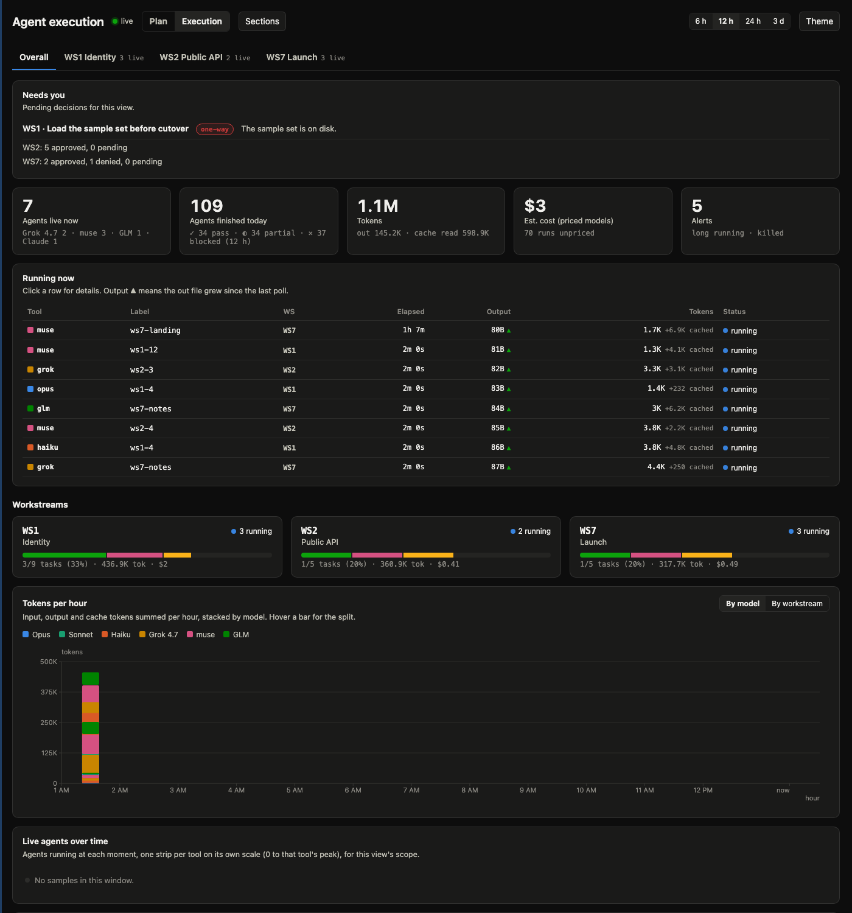
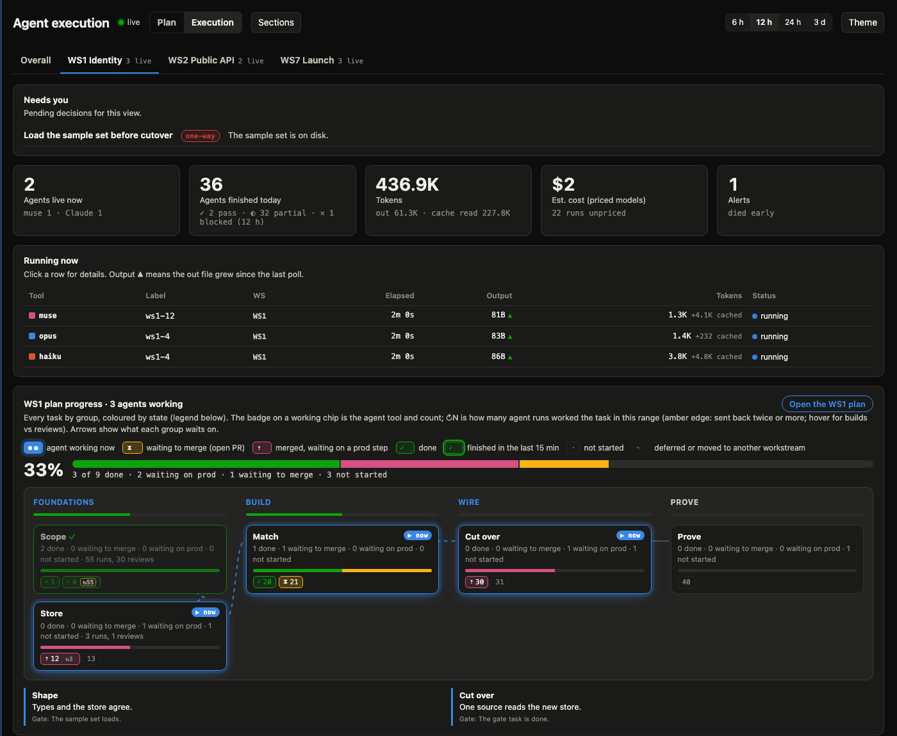
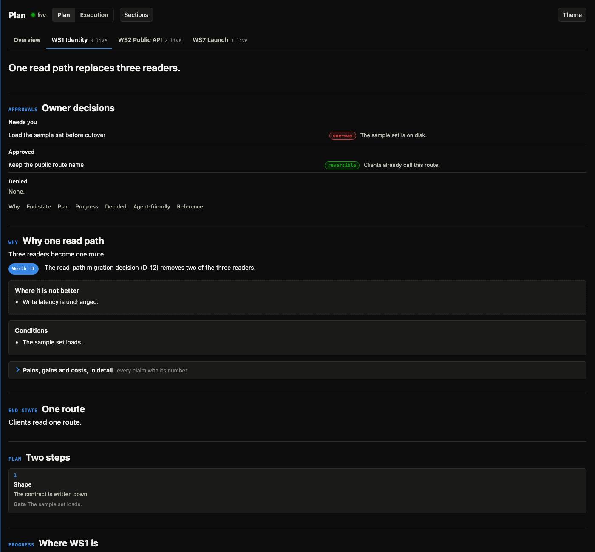
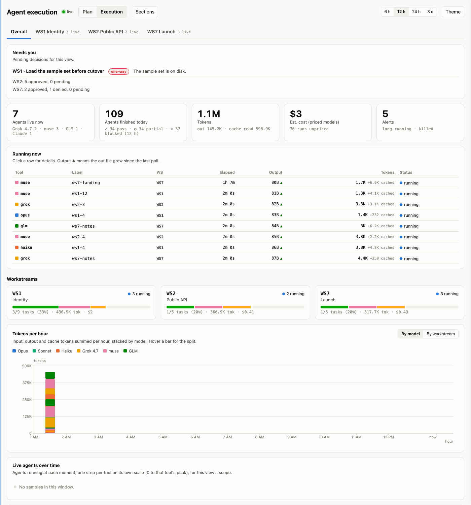
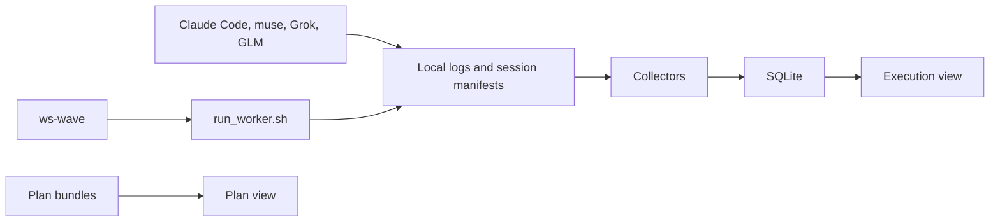

# workflow-skills

A local dashboard and a small kit for running many coding agents at once. You plan a workstream, send the independent lanes out in a wave, watch the agents on one page, and see what the tokens cost. Claude Code is the lead. muse does the lane work by default, and Grok when a lane asks for it. The dashboard reads their logs, and also Claude and GLM sessions that are already on the machine. It binds to 127.0.0.1, reads logs, and stores labels.

## Screenshots

All captured from the bundled sample data (no real runs).

| | |
|---|---|
|  |  |
| **Execution overview.** Live agents, finished runs, tokens and cost, workstream progress, and every run. | **Live plan map.** Overall progress, the groups being worked on now (glowing), ready-next groups, flowing dependency arrows, and agents pinned to their task chips with attempt counts. |
|  |  |
| **Plan view.** The workstream's decisions, motivation, end state and phases, and owner approvals. One toggle switches to Execution without a reload. | **Light theme.** The Needs you card lists pending owner approvals across workstreams. |

## What you get

| Piece | Path | What it does |
|---|---|---|
| workstream-dashboard | [skills/workstream-dashboard/SKILL.md](skills/workstream-dashboard/SKILL.md) | Runs and changes the local dashboard. |
| workstream-planner | [skills/workstream-planner/SKILL.md](skills/workstream-planner/SKILL.md) | Turns a goal into a plan bundle, an execution plan, owner approvals, and a kickoff brief. |
| workstream-lead | [skills/workstream-lead/SKILL.md](skills/workstream-lead/SKILL.md) | Runs that bundle wave by wave and moves task status as the facts change. |
| agent-dash | [tools/agent-dash](tools/agent-dash/README.md) | The page, the collectors, and the `ws` commands. State lives in `~/.local/share/agent-dash/`. |
| ws-wave | [tools/agent-dash/workflows/ws-wave.js](tools/agent-dash/workflows/ws-wave.js) | One wave. Each lane is built, reviewed, and fixed until it is approved or out of rounds. |
| Worker launchers | [run_worker.sh](tools/agent-dash/scripts/run_worker.sh), [launch_grok.sh](tools/agent-dash/scripts/launch_grok.sh) | Start one muse or Grok worker and write the session row the dashboard reads. |
| Sample data | [tools/agent-dash/fixtures](tools/agent-dash/fixtures) | Seeded runs, plans, and approvals for the offline preview. The generator does not read your sessions. |

Shipped plan files for WS1, WS2, and WS7 are synthetic, so the live page has tabs before you add a bundle of your own.

## How it works

Agents and CLIs write local logs. Collectors tail those logs into SQLite. The Execution view reads that database. Plan bundles on disk feed the Plan view. `ws-wave` drives the workers, and the workers write the logs the collectors already watch.



The concepts page explains [workstreams, labels, approvals, tokens, and live counts](docs/concepts.md).

## Ten-minute quickstart

The long form, with the output each command prints, is [docs/quickstart.md](docs/quickstart.md). The short path:

1. Clone this repository into a directory named `workflow-skills` and run `./install.sh` from that directory. The script symlinks every skill and every tool into `~/.claude/`. Running it again is safe.
2. Start the dashboard.

```bash
python3 ~/.claude/tools/agent-dash/agent_dash.py run
```

The command prints `running`, a pid, and `url http://127.0.0.1:8765/`. Open that URL.

3. In another terminal, from `tools/agent-dash` inside the clone, serve the sample data.

```bash
python3 -m http.server 8766 --bind 127.0.0.1
```

Open http://127.0.0.1:8766/static/index.html?fixtures&theme=dark . Stop that server with Control-C when you have seen the page. The dashboard on port 8765 keeps running.

4. Create a workstream, then render and check it.

```bash
python3 ~/.claude/tools/agent-dash/agent_dash.py ws new WS4 "Notes index"
python3 ~/.claude/tools/agent-dash/agent_dash.py ws render WS4
python3 ~/.claude/tools/agent-dash/agent_dash.py ws validate WS4
```

`validate` prints `OK WS4`. Open http://127.0.0.1:8765/?view=plan&ws=WS4 .

5. Run one wave with `ws-wave`, muse by default, and watch WS4 on the dashboard. The arguments, the task map, and the scratch directory the collectors actually scan are in the [quickstart](docs/quickstart.md).

## Privacy

The page binds to 127.0.0.1 on port 8765. Configuration cannot move that address. Collectors read logs and process samples. `stop` signals only the dashboard pid in the pidfile. The database keeps labels, timings, and token counts. Prompt bodies, argv, secrets, and environment values stay unread.

Plan bundles live under `~/.local/share/agent-dash/workstreams/` and stay out of this repository. Files named `*.local.json` are gitignored. Do not commit a session id, a home-directory path, or a token dump.

`scripts/privacy_audit.sh` fails when a tracked file contains a personal path, a private project name, or key material. Run it before you push.

## Read next

- [Quickstart](docs/quickstart.md) for the copy-paste path, including one wave.
- [Concepts](docs/concepts.md) for workstreams, the map, labels, approvals, tokens, and live counts.
- [Configuration](docs/configuration.md) for example files, local overrides, environment variables, and a new data source.
- [Running a workstream end to end](tools/agent-dash/docs/workstream-lead.md) for the lead loop after the first wave.

## Workers

Workers come from a registry: [`tools/agent-dash/workers.example.json`](tools/agent-dash/workers.example.json), replaced on one machine by a gitignored `workers.local.json` (or `AGENT_DASH_WORKERS`). Each worker has a kind (muse, cursor-agent, or Grok Build CLI), a model, a concurrency cap and quota patterns. `scripts/run_worker.sh` and the `ws-wave` workflow take `default` (the registry's default worker), a worker name, or `auto`. `auto` starts the first worker in `auto_order` that is under its cap and not cooling down after a quota error, and relaunches a lane on the next one when it hits a limit.
