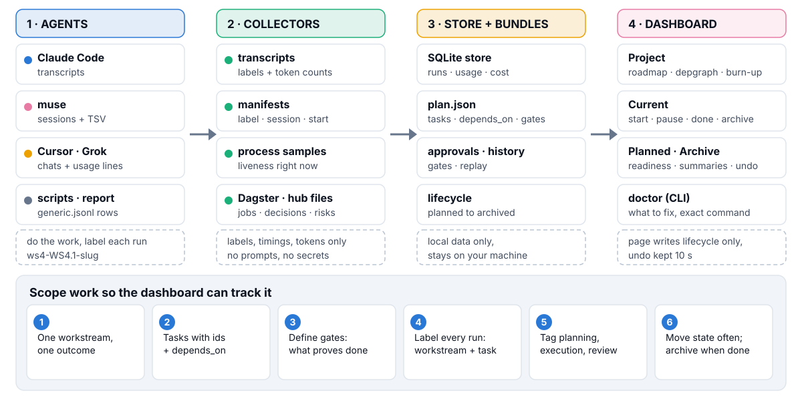

# agent-dash

The local page for this kit. It reads transcripts, manifests, and process samples on your machine and shows runs, token use, and a plan map per workstream.


Start with [Plug in any agent](docs/integrate.md): install and run in three commands, one reporting path per harness, labels, verdicts, pricing, and troubleshooting. The contract is [CONTRACT.md](CONTRACT.md). The Project home "Planning versus execution" card splits each workstream's tokens and cost into planning, execution, review, coordination, and unclassified from run labels (`catalog/phases.json` rules — the file name is historical — `GET /api/project/phases`). The repository root holds the [landing page](../../README.md), [quickstart](../../docs/quickstart.md), [concepts](../../docs/concepts.md), and [configuration](../../docs/configuration.md).

The page binds to 127.0.0.1 port 8765. That address is fixed. Lifecycle controls from the page are the one write action: local, header-guarded, off with AGENT_DASH_READONLY=1.

## Install

From the repository root:

```bash
./install.sh
```

The script symlinks this directory to `~/.claude/tools/agent-dash` and each skill into `~/.claude/skills/`. A second run is safe.

## Run

```bash
python3 ~/.claude/tools/agent-dash/agent_dash.py run
python3 ~/.claude/tools/agent-dash/agent_dash.py status
python3 ~/.claude/tools/agent-dash/agent_dash.py restart
python3 ~/.claude/tools/agent-dash/agent_dash.py check
python3 ~/.claude/tools/agent-dash/agent_dash.py doctor
python3 ~/.claude/tools/agent-dash/agent_dash.py reprice
python3 ~/.claude/tools/agent-dash/agent_dash.py reconcile
python3 ~/.claude/tools/agent-dash/agent_dash.py backfill --session <id>
python3 ~/.claude/tools/agent-dash/agent_dash.py report start --label ws4-WS4.1-slug --model <model> --session <id>
python3 ~/.claude/tools/agent-dash/agent_dash.py ws list
python3 ~/.claude/tools/agent-dash/agent_dash.py project list
```

`run` prints `running`, a pid, and `url http://127.0.0.1:8765/`.

### Command Code workers (`cmd`)

`scripts/launch_cmd.py <label> <workspace> <prompt-file> <outdir>` runs one
headless `cmd -p` worker on the free models, rotating to the next model
when one throttles (15 minute cooldown, up to 8 attempts). `outdir` is any
folder the dashboard scans, such as a scratchpad `cmd/` folder. It writes
`cmd-sessions.tsv` (one row per attempt: model, session, tokens, status
`ok`, `throttled` or `failed rc=N`), `running/<label>` while an attempt is
live, `stream-<label>-<n>.ndjson`, `out-<label>.md` and `err-<label>.log`.
The `commandcode` source reads those rows and the session files under
`~/.commandcode/projects`. Unlabelled Command Code sessions show as runs with
no label. Throttled attempts show as `died_early` with verdict `QUOTA`.

### pi workers (`launch_pi.py`)

`scripts/launch_pi.py <label> <workspace> <prompt-file> <outdir> [--model M]`
runs one headless `pi` (`@mariozechner/pi-coding-agent`) worker on the
River AI provider, defaulting to
`river/deepseek-ai/DeepSeek-V4.1-Flash-1017` (use
`--model river/zai-org/GLM-5.3-Flash` for GLM). `outdir` is any folder the
dashboard scans, such as a scratchpad `pi/` folder. It writes
`pi-sessions.tsv` (label, session id, start epoch, model),
`stream-<label>.ndjson`, `out-<label>.md`, `err-<label>.log`, and
`running/<label>` while the run is live, and appends `generic.jsonl`
start/usage/finish lines (run id `pi:<session>:<label>`). The `pi` source
reads the manifest and a `pi/` folder beside it, takes status and verdict
from the files, and reads liveness from the live `node .../pi-coding-agent`
process. Quota/credit exhaustion finishes `died_early` with verdict
`BLOCKED` and writes `QUOTA` naming the model and label. See
[docs/integrate.md](docs/integrate.md).

## Config

Zero config runs. `config.local.json` deep-merges over `config.example.json`. The full tables are in [configuration](../../docs/configuration.md).

## Links

- [Plug in any agent](docs/integrate.md)
- [Run DeepSeek through Grok Build](docs/integrate.md#run-deepseek-through-grok-build) ([config](../../docs/configuration.md#grok-configdeepseekexampletoml), [key-free template](catalog/grok-config.deepseek.example.toml))
- [CONTRACT.md](CONTRACT.md)
- [quickstart](../../docs/quickstart.md) and [concepts](../../docs/concepts.md)
- [landing page](../../README.md)
